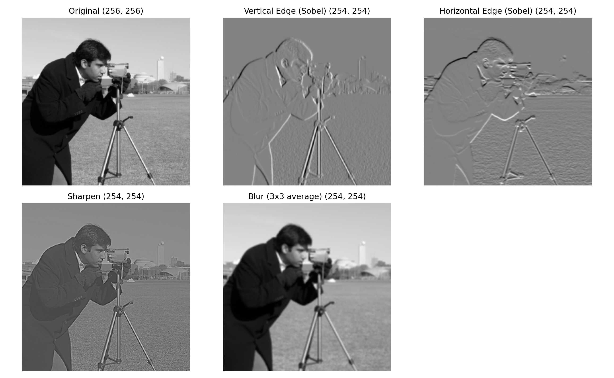
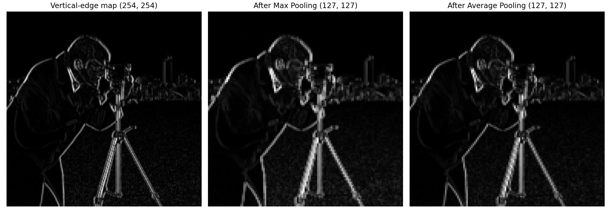

# Understanding Convolution and Pooling

Convolution and pooling implemented from scratch in Python (NumPy) to show how a CNN extracts features from an image.

## Overview

- **Convolution:** a small filter slides over the image and produces a feature map that highlights a specific pattern (edges, sharpness, smoothness).
- **Pooling:** shrinks a feature map by keeping a summary of each small region, which cuts size and keeps the strongest signals.

## What this project does

1. **Loads** a built-in grayscale sample image (scikit-image `camera`), resized to 256 x 256.
2. **Applies 4 convolution filters** (3 x 3, stride 1, no padding): vertical edge (Sobel), horizontal edge (Sobel), sharpen, and blur.
3. **Applies 2 x 2 pooling** (max and average) on the vertical-edge feature map.
4. **Visualizes** the original image and all the generated feature maps.

## Results

### Convolution

| Filter | Effect |
|---|---|
| Vertical edge (Sobel) | Highlights vertical edges (tripod legs, coat outline) |
| Horizontal edge (Sobel) | Highlights horizontal edges (shoulder line, horizon) |
| Sharpen | Boosts contrast along edges so details look crisper |
| Blur (3x3 average) | Smooths the image and removes fine detail |

Each 3 x 3 filter turns the 256 x 256 image into a 254 x 254 feature map.



### Pooling

| Stage | Shape |
|---|---|
| Vertical-edge feature map | 254 x 254 |
| After max pooling (2x2) | 127 x 127 |
| After average pooling (2x2) | 127 x 127 |

Pooling cuts the number of values by 4 times while the main edges stay visible. Max pooling keeps edges bright and sharp, and average pooling gives a smoother, dimmer result.



### Pooling example (4 x 4 matrix)

```
Input:            Max pooled:     Average pooled:
[[1 3 2 4]        [[6 4]          [[3.75 2.25]
 [5 6 1 2]         [7 9]]          [4.   7.  ]]
 [7 2 9 8]
 [3 4 5 6]]
```

## Notes

- The `convolve2d` function does not flip the kernel, which is how deep learning libraries implement "convolution" (technically cross-correlation).
- In a real CNN the filter values are **learned during training**, not hand-picked like these.

## Tech Stack

Python, NumPy, Matplotlib, scikit-image

## How to Run

Open the notebook in Google Colab (or Jupyter) and run all cells. If running locally, first install the libraries:

```bash
pip install numpy matplotlib scikit-image
```

## Files

- `YOUR_NOTEBOOK_NAME.ipynb`: full code and output
- `convolution_results.png`: original image and filtered feature maps
- `pooling_results.png`: edge map, max-pooled, and average-pooled results
- `README.md`: project documentation

## Author

Poojashree
